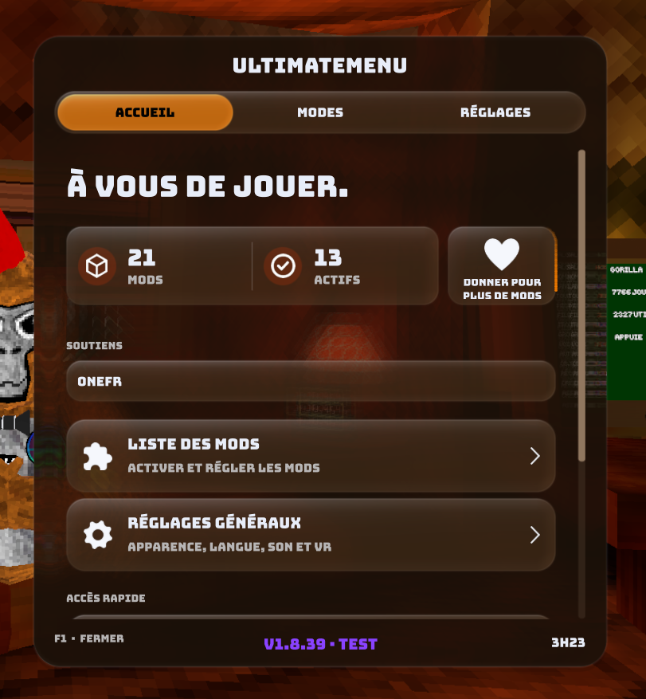
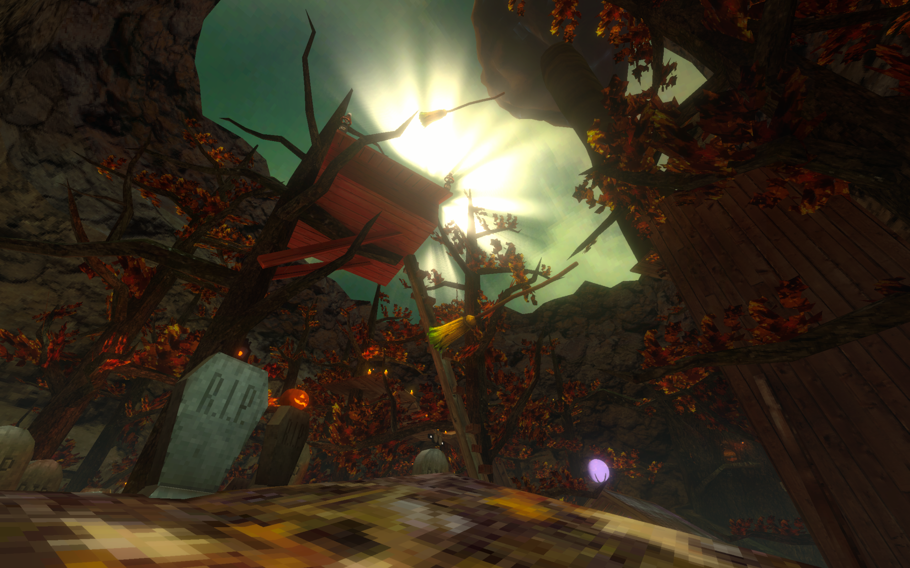

# 🦍 UltimateMenu

**Mod menu pour Gorilla Tag avec interface liquid glass, sur PC et en VR**

**Version actuelle : v1.8.39** · **18 langues**

  
  &nbsp;
  
  &nbsp;
  
  &nbsp;
  

[Télécharger](https://github.com/MATTRAX64/UltimateMenu/releases) · [Signaler un bug](https://github.com/MATTRAX64/UltimateMenu/issues) · [Contact](https://mattraxer64xp.page.gd)

> Ce projet n'est pas affilié à Another Axiom ni à Gorilla Tag.  
> Ce projet utilise l’IA pour compresser et optimiser avant leur envoi sur GitHub.

---

## ✨ Nouveautés v1.8

* **Interface liquid glass Réaliste** PostProcessing URP fonctionnel !

## 🧩 Fonctionnalités

* Modifier des éléments visuels et en rajouter
* Modifier des interactions de personnage, camera
* Exporter, Importer des profils
* Optimisation Unity - Discord Rich Presence

Chaque mod a ses réglages on peut aussi gérer l'apparence, la langue, le son.

---

## 📦 Installation

1. Installe [BepInEx](https://github.com/MATTRAX64/GorillaTagModInstaller) pour Gorilla Tag.
2. Télécharge `UltimateMenu.dll` depuis les [Releases](https://github.com/MATTRAX64/UltimateMenu/releases).
3. Place-le dans le bonne emplacement :
   - **Steam:** `C:\Program Files (x86)\Steam\steamapps\common\Gorilla Tag\BepInEx\plugins\`
   - **Meta PC (Oculus):** `C:\Program Files\Oculus\Software\Software\another-axiom-gorilla-tag\BepInEx\plugins\`
4. Lance le jeu.

---

## 🎮 Utilisation

Un tutoriel **obligatoire** sera afficher en jeu pour ouvrir en jeu et pour la version ordinateur la touche est montrer dès le chargement.

### Blender et objets 3D

* **Mocap** : le module Blender se trouve dans `Assets\GorillaMocap\`. Installe-le comme module complémentaire dans Blender, puis ouvre le panneau latéral avec la touche **N**.
* **Objets 3D** : `Assets\GorillaSpawners\AutoBundle.unitypackage` sert à créer tes propres bundles avec la version de Unity utilisée par Gorilla Tag.

---

## 📁 Fichiers / Dociers créés par le menu

Ils se trouvent dans `BepInEx\plugins\UltimateMenu\`.

| Fichier / Dociers | Contenu |
| :--- | :--- |
| `📄 Profile.json` | Réglages du menu |
| `📁 GorillaFaces` | Images de visage personnalisé |
| `📁 GorillaMocap` | Exports Mocap pour Blender |
| `📁 GorillaSpawners` | Fichiers `.bundle` des objets 3D |
| `📁 GorillaStreams` | Texte pour OBS (code de la salle et nombre de joueurs) |
| `📁 CrashReports` | Rapports d'erreurs, si l'envoi est activé |

---

## 🔐 Confidentialité

* **Rapports d'erreurs** : Activé par défaut pour récupérer les erreurs pour les régler après on peut toujours desactiver le Rapports d'erreurs dans les settings du mod menu.
* **Vérification de version** : le menu interroge l'API GitHub au lancement.

---

## ⚠️ Avertissement

Utiliser un mod peut entraîner un bannissement selon les règles du jeu. Utilise-le à tes propres risques, et de façon responsable.

---

**MATTRAX** · [Contact](https://mattraxer64xp.page.gd) · [Patreon](https://www.patreon.com/c/MATTRAXER64xp)

