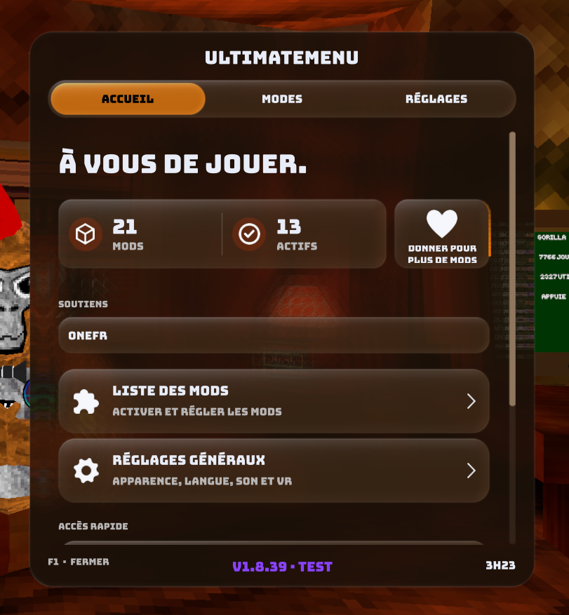
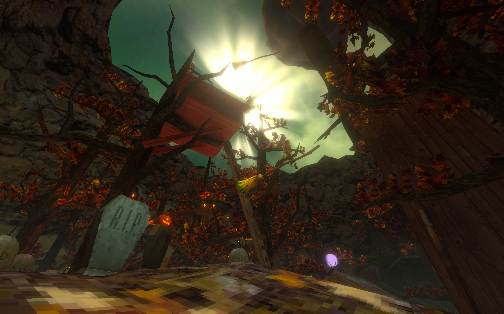

# 🦍 UltimateMenu

**A Gorilla Tag mod menu with a Liquid Glass interface for desktop and VR**

**Current version: v1.8.39** · **18 languages**

  
  &nbsp;
  
  &nbsp;
  

[Download](https://github.com/MATTRAX64/UltimateMenu/releases) · [Report a bug](https://github.com/MATTRAX64/UltimateMenu/issues) · [Contact](https://mattraxer64xp.page.gd)

> This project is independent of Another Axiom and Gorilla Tag.  
> This project uses AI to help compress and optimize files before uploading them to GitHub.

---

## ✨ What's new in v1.8

- **Realistic Liquid Glass interface** with working URP post-processing.

## 🧩 Features

- Customize visuals and add new visual elements.
- Customize character and camera interactions.
- Import and export profiles.
- Improve Unity performance and display your activity with Discord Rich Presence.

Each mod has its own settings. You can also customize the menu’s appearance, language, and sound.

---

## 📦 Installation

1. Install [BepInEx for Gorilla Tag](https://github.com/MATTRAX64/GorillaTagModInstaller).
2. Download `UltimateMenu.dll` from [Releases](https://github.com/MATTRAX64/UltimateMenu/releases).
3. Place the DLL in `C:\Program Files (x86)\Steam\steamapps\common\Gorilla Tag\BepInEx\plugins`.
4. Launch the game.

---

## 🎮 Usage

A **required tutorial** shows you how to open the menu in VR. On desktop, the menu hotkey appears when the mod loads.

### Blender and 3D objects

- **Mocap**. The Blender add-on is in `Assets/GorillaMocap/`. Install the add-on in Blender, then press **N** to open the sidebar.
- **3D objects**. Use `Assets/GorillaSpawners/AutoBundle.unitypackage` to create your own bundles with the Unity version used by Gorilla Tag.

---

## 📁 Files and folders created by the menu

The menu stores these in `BepInEx/plugins/UltimateMenu/`.

| File or folder | Contents |
| :--- | :--- |
| 📄 `Profile.json` | Menu settings |
| 📁 `GorillaFaces` | Custom face images |
| 📁 `GorillaMocap` | Mocap exports for Blender |
| 📁 `GorillaSpawners` | 3D object `.bundle` files |
| 📁 `GorillaStreams` | Text for OBS, including the room code and player count |
| 📁 `CrashReports` | Error reports when reporting is enabled |

---

## 🔐 Privacy

- **Error reporting** is enabled by default to help diagnose and fix issues. You can turn it off in the mod menu settings.
- **Update checks** use the GitHub API at startup.

---

## ⚠️ Warning

Using mods may result in a ban under the game's rules. Use this mod responsibly and at your own risk.

---

**MATTRAX** · [Contact](https://mattraxer64xp.page.gd) · [Patreon](https://www.patreon.com/c/MATTRAXER64xp)

