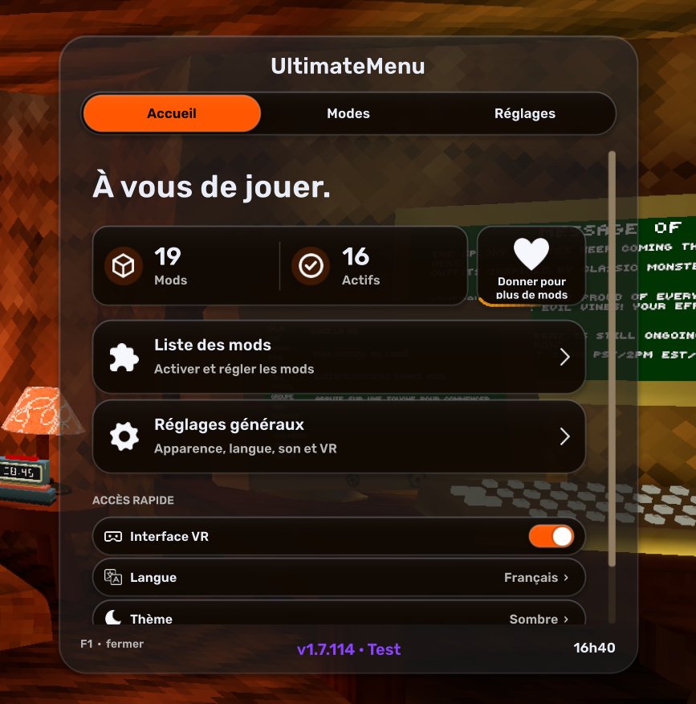

# 🦍 UltimateMenu

**Mod menu pour Gorilla Tag avec interface liquid glass, sur PC et en VR**

**Version actuelle : v1.7.114** · **18 langues**

[Télécharger](https://github.com/MATTRAX64/UltimateMenu/releases) · [Signaler un bug](https://github.com/MATTRAX64/UltimateMenu/issues) · [Contact](https://mattraxer64xp.page.gd)

> Ce projet n'est pas affilié à Another Axiom ni à Gorilla Tag.

---

## ✨ Nouveautés v1.7

* **Interface liquid glass** repensée, avec 9 polices intégrées et plusieurs thèmes.
* **18 langues** disponibles.

## 🧩 Fonctionnalités

| Catégorie | Ce que tu peux faire |
| :--- | :--- |
| 🎥 **Caméra et capture** | Caméra spectateur, Mocap pour Blender, filtres d'écran, overlay OBS |
| 🕺 **Corps** | Suivi corporel (plusieurs modes) et ragdoll |
| 👥 **Social** | Chat vocal, étiquettes de nom, visages personnalisés, salles, objets 3D |
| 🌦 **Environnement** | Météo et heure, textes à l'écran, optimisation et compteur FPS |

Chaque mod a ses réglages dans l'onglet **Modes**. L'onglet **Accueil** gère l'apparence, la langue, le son et la VR.

---

## 📦 Installation

1. Installe [BepInEx](https://github.com/BepInEx/BepInEx) sur Gorilla Tag.
2. Télécharge `UltimateMenu v1.7.114.dll` depuis les [Releases](https://github.com/MATTRAX64/UltimateMenu/releases).
3. Place-le dans `BepInEx\plugins\UltimateMenu\`.
4. Lance le jeu.

---

## 🎮 Utilisation

* **PC** : ouvre le menu avec la touche configurée dans les réglages.
* **VR** : stick droit, bas puis haut pour ouvrir, haut puis bas pour fermer. Gâchette gauche pour valider, bouton X pour revenir.

Un mod doit être **activé** avant que ses réglages soient accessibles.

### Blender et objets 3D

* **Mocap** : le module Blender se trouve dans `Assets\GorillaMocap\`. Installe-le comme module complémentaire dans Blender, puis ouvre le panneau latéral avec la touche **N**.
* **Objets 3D** : `Assets\GorillaSpawners\AutoBundle.unitypackage` sert à créer tes propres bundles avec la version de Unity utilisée par Gorilla Tag.

---

## 📁 Fichiers créés par le menu

Ils se trouvent dans `BepInEx\plugins\UltimateMenu\`.

| Fichier | Contenu |
| :--- | :--- |
| `Profile.json` | Réglages du menu |
| `GorillaFaces\` | Images de visage personnalisé |
| `GorillaMocap\` | Exports Mocap pour Blender |
| `GorillaSpawners\` | Fichiers `.bundle` des objets 3D |
| `GorillaStreams` | Texte pour OBS (code de la salle et nombre de joueurs) |
| `CrashReports\` | Rapports d'erreurs, si l'envoi est activé |

---

## 🔐 Confidentialité

* **Rapports d'erreurs** : désactivés par défaut. Si tu les actives, les erreurs sont envoyées en issues publiques sur GitHub, avec ton pseudo, ta configuration et le texte de l'erreur. Les chemins et les clés sont masqués.
* **Vérification de version** : le menu interroge l'API GitHub au lancement.

---

## ⚠️ Avertissement

Utiliser un mod peut entraîner un bannissement selon les règles du jeu. Utilise-le à tes propres risques, et de façon responsable.

---

**MATTRAX** · [Contact](https://mattraxer64xp.page.gd) · [Patreon](https://www.patreon.com/c/MATTRAXER64xp)

