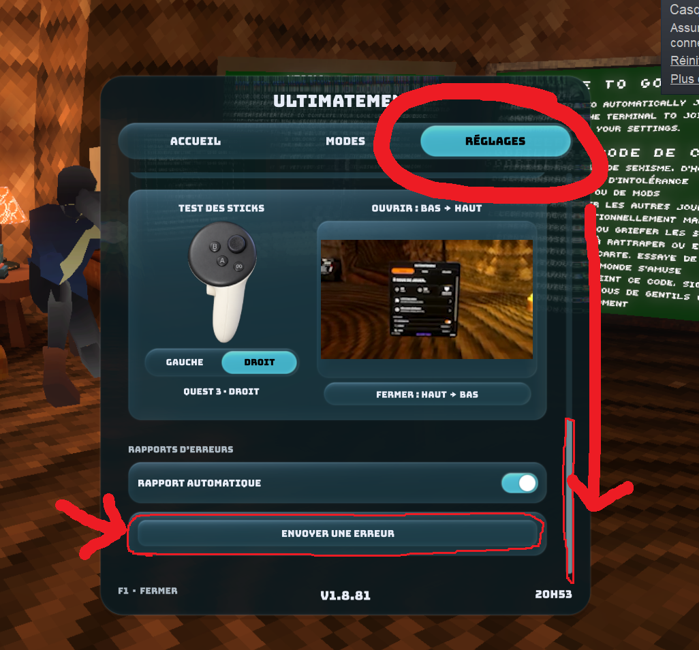

# Security Policy

## Report a security vulnerability

Please report vulnerabilities privately. Include the affected UltimateMenu version, a short description, and steps to reproduce the issue. Remove personal information, tokens, and private keys from any logs or screenshots you share. Keep vulnerability details private while the report is being reviewed. [Contact MATTRAX privately](https://mattraxer64xp.page.gd)

## Report a bug

For crashes, visual glitches, and other bugs, open **UltimateMenu → Settings → Error Reports → Send a Report**. Choose a category and describe what happened. You can also report regular bugs directly on GitHub. [GitHub Issues](https://github.com/MATTRAX64/UltimateMenu/issues)

## GitHub issue reporting

UltimateMenu’s in-game reporter uses a dedicated GitHub App to create issues. The presence of its credential in builds that include the reporter is intentional. A private key embedded in a distributed build can be extracted, so please report any suspected misuse privately. [Contact MATTRAX](https://mattraxer64xp.page.gd)
